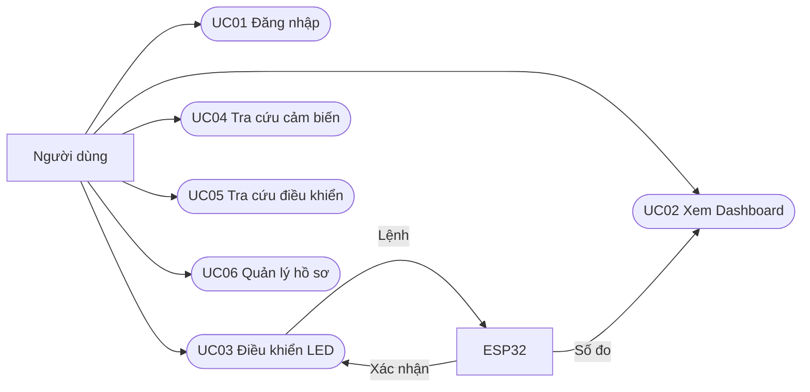

# CHƯƠNG 2. PHÂN TÍCH

## 2.1. Bài toán và đối tượng tương tác

Người dùng truy cập Web để xem môi trường, gửi lệnh LED và tra cứu dữ liệu. Hệ thống hiện có ba tài khoản cùng nhóm chức năng; mỗi người xem/sửa hồ sơ của chính mình và có thể xem lịch sử chung với người thực hiện của từng lệnh. Đây không phải ba vai trò phân quyền. ESP32 là thành phần tương tác bên ngoài ứng dụng Web, cung cấp telemetry và phản hồi trạng thái. Backend đóng vai trò trung tâm kiểm tra dữ liệu, xử lý nghiệp vụ và đồng bộ giữa cơ sở dữ liệu với giao diện.

Đầu vào của hệ thống gồm thông tin đăng nhập, giá trị cảm biến, yêu cầu ON/OFF, điều kiện tìm kiếm và thông tin hồ sơ. Đầu ra gồm phiên xác thực, số đo và biểu đồ, trạng thái thiết bị, lịch sử điều khiển và kết quả truy vấn. Frontend không kết nối trực tiếp tới MySQL hoặc broker MQTT.

## 2.2. Yêu cầu chức năng

| Use case | Chức năng | Kết quả mong đợi | Mục thiết kế |
| --- | --- | --- | --- |
| UC01 | Đăng nhập | Tài khoản hợp lệ nhận phiên; yêu cầu không hợp lệ bị từ chối | 3.4 |
| UC02 | Giám sát Dashboard | Xem ba số đo, biểu đồ và tình trạng phần cứng; nhận cập nhật realtime | 3.5 |
| UC03 | Điều khiển LED | Gửi ON/OFF, theo dõi chờ xác nhận, xác nhận hoặc timeout | 3.6 |
| UC04 | Tra cứu dữ liệu cảm biến | Tìm theo trường đã chọn, sắp xếp và phân trang | 3.7 |
| UC05 | Tra cứu lịch sử điều khiển | Xem username người thực hiện; lọc thiết bị, lệnh, trạng thái và thời gian | 3.8 |
| UC06 | Quản lý hồ sơ | Xem, sửa hoặc hủy thay đổi thông tin cá nhân | 3.9 |

Sáu use case được thể hiện trên năm màn hình; UC03 dùng các card LED ngay tại Dashboard.

**Hình 2.1. Sơ đồ chức năng tổng quát — bản nguồn cần xuất hình.**

Sơ đồ trên biểu diễn phạm vi chức năng, không phải sơ đồ mạng triển khai. Các chức năng UC02–UC06 yêu cầu phiên đăng nhập hợp lệ.

## 2.3. Yêu cầu dữ liệu

### 2.3.1. Cảm biến và thiết bị

| Mã Sensor | Đại lượng | Nguồn | Đơn vị |
| --- | --- | --- | --- |
| DHT11_TEMP | Nhiệt độ | DHT11 | °C |
| DHT11_HUM | Độ ẩm | DHT11 | %RH |
| LDR_LIGHT | Ánh sáng | LDR và ADC | lux ước lượng |

Hai Device có mã LED1 và LED2. Mỗi Device lưu trạng thái ON/OFF được Backend ghi nhận. Không dùng bảng Device để đại diện cho cả ESP32.

### 2.3.2. Các nhóm dữ liệu

| Đối tượng | Ý nghĩa |
| --- | --- |
| User | Ba tài khoản hiện có; thông tin xác thực/hồ sơ riêng, liên kết các lệnh đã gửi |
| Sensor | Danh mục nguồn đo, loại, đơn vị và trạng thái sử dụng |
| SensorData | Một reading của một Sensor tại một thời điểm lưu |
| Device | Danh mục LED và trạng thái đã ghi nhận |
| ActionHistory | Người yêu cầu, thiết bị, lệnh, trạng thái và thời điểm xác nhận |

Mỗi MQTT reading hợp lệ tạo một hàng SensorData độc lập. Thiết kế hiện tại không có bảng gộp một chu kỳ ba cảm biến. Vì payload không chứa thời điểm đo hoặc mã chu kỳ, Backend không thể chứng minh ba reading có cùng thời điểm lấy mẫu chỉ dựa vào thời gian nhận.

## 2.4. Quy tắc nghiệp vụ

| Mã | Quy tắc |
| --- | --- |
| QT01 | Chỉ lưu reading của Sensor đã đăng ký, đang hoạt động và có giá trị hợp lệ |
| QT02 | Dashboard giữ tối đa 15 reading mới nhất cho mỗi Sensor; số nhãn thời gian có thể ít hơn số điểm trên màn hình nhỏ |
| QT03 | Hardware được đánh giá Online khi còn telemetry hợp lệ trong ngưỡng 30 giây; Offline vẫn giữ dữ liệu cuối |
| QT04 | Mỗi yêu cầu LED hợp lệ được ghi lịch sử trước khi publish; requestId chính là ActionHistory.id |
| QT05 | HTTP 202 chỉ thông báo tiếp nhận yêu cầu; Device.status được cập nhật theo phản hồi hợp lệ |
| QT06 | Chưa xác nhận trong 10 giây là TIMEOUT; không tự suy ra LED đã thực hiện lệnh |
| QT07 | Xác nhận lặp không thay thời điểm xác nhận đầu; xác nhận cũ không ghi đè trạng thái của yêu cầu mới hơn đã xác nhận |
| QT08 | Processing tương ứng yêu cầu đang PENDING; status lưu trong dữ liệu vẫn chỉ ON/OFF |
| QT09 | UI mặc định 5 dòng/trang, cho chọn 5/10/15/20; API giới hạn tối đa 20 |
| QT10 | Thời gian lưu và JSON theo UTC, giao diện hiển thị giờ Việt Nam; định dạng một chữ số không làm tròn dữ liệu đã lưu |
| QT11 | Client không tự tạo reading hoặc giả lập phản hồi LED; dữ liệu nghiệp vụ do Backend quản lý |
| QT12 | Người gửi lệnh được xác định từ subject của JWT; username hiển thị qua ActionHistory.userId, không nhận từ body và không lấy tài khoản đang xem lịch sử |
| QT13 | Khởi động lại chỉ thêm tài khoản seed còn thiếu; không đặt lại mật khẩu/hồ sơ hoặc tạo trùng người dùng |

Action và status có ý nghĩa khác nhau: action là thao tác người dùng yêu cầu, còn status phản ánh trạng thái ghi nhận của yêu cầu/thiết bị. Trạng thái xử lý PENDING, CONFIRMED, TIMEOUT được xác định thêm từ lịch sử và thời gian; không bổ sung giá trị PROCESSING vào cột ON/OFF.

## 2.5. Yêu cầu phi chức năng

| Nhóm | Yêu cầu | Cách đánh giá |
| --- | --- | --- |
| Xác thực | Mật khẩu BCrypt; API cần JWT; STOMP kiểm tra phiên và giới hạn topic | Đối chiếu SecurityConfig, interceptor và các phép thử xác thực |
| Nhất quán | Event phản ánh dữ liệu đã commit; nhận gói đến muộn không kéo lùi card mới hơn | Đối chiếu transaction, publisher và logic cập nhật Dashboard |
| Phản hồi | Hiển thị trạng thái tải, rỗng, lỗi, đang chờ và hết thời gian | Quan sát từng trạng thái UI; lưu ảnh có nguồn rõ ràng |
| Khôi phục | Tải lại snapshot khi WebSocket kết nối lại; giữ dữ liệu cuối khi phần cứng Offline | Kiểm tra logic reconnect và thử nghiệm tương ứng |
| Lưu trữ | Cấu hình ngoài source, dữ liệu MySQL có volume bền vững | Kiểm tra cấu hình; không xóa volume khi chuyển môi trường |
| Trình bày | Một biểu đồ ba đường, đơn vị và thời gian rõ, thao tác LED dễ phân biệt | Quan sát Dashboard và tooltip với dữ liệu thật |

Các yêu cầu trên là tiêu chí thiết kế. Việc có mã nguồn xử lý một trường hợp không tự chứng minh trường hợp đó đã được kiểm thử phần cứng. Báo cáo không tự đặt cam kết về uptime, tải lớn hoặc độ trễ khi chưa có phép đo phù hợp.

## 2.6. Kịch bản đánh giá

Phiên đánh giá gồm: truy cập ứng dụng → đăng nhập → quan sát số đo và biến đổi ánh sáng → gửi ON/OFF hai LED → đối chiếu lịch sử → tìm kiếm cảm biến → xem hồ sơ → rút ESP32 → kiểm tra Offline và timeout.

Kết quả được chia thành ba mức: đã quan sát và có bằng chứng; được mô tả trong source/contract nhưng chưa đo ở phiên này; cần bổ sung kiểm thử. Đặc biệt, ảnh Web có trạng thái ON và MQTT xác nhận chứng minh luồng phần mềm, còn ảnh mạch/Serial được bổ sung riêng để minh họa phần vật lý. Các kết quả cụ thể được đặt cuối từng chức năng tại Chương 3.

Sau cập nhật đa tài khoản, bổ sung kịch bản: lần lượt đăng nhập ba tài khoản → kiểm tra hồ sơ đúng chủ thể → đọc các trang lịch sử chung → đối chiếu username với User liên kết trong SQL. Kiểm thử tạo lệnh dưới ba JWT và từ chối giả mạo userId/username được thực hiện trên H2/MQTT mock; không xem đây là ba phép điều khiển ESP32 thật.
