# CHƯƠNG 3. THIẾT KẾ

## 3.1. Kiến trúc tổng thể

### 3.1.1. Các thành phần và vai trò

Hệ thống được chia thành phần thu thập/chấp hành, phần xử lý trung tâm và phần giao diện. ESP32 đọc DHT11, LDR và nhận lệnh LED. Mosquitto chuyển tiếp MQTT giữa ESP32 và Backend. Spring Boot xử lý nghiệp vụ, lưu MySQL, cung cấp REST và phát sự kiện STOMP. React hiển thị dữ liệu và gửi thao tác người dùng.

**Hình 3.1. Kiến trúc logic.**

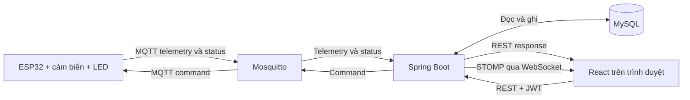

Ba giao thức phục vụ các mục tiêu khác nhau: MQTT trao đổi với phần cứng; REST tải snapshot, truy vấn và tiếp nhận thao tác; STOMP/WebSocket đẩy thay đổi tới Web. Frontend không truy cập broker hoặc cơ sở dữ liệu trực tiếp.

### 3.1.2. Môi trường triển khai

| Thành phần | Cách triển khai hiện tại | Địa chỉ/cổng theo vai trò |
| --- | --- | --- |
| React + Nginx + Spring Boot | Chung container `iot_project_app` | Trình duyệt vào `localhost:8088`; Nginx chuyển API/WS tới Spring Boot cổng 8080 bên trong |
| Eclipse Mosquitto | Service broker trong Compose | Backend dùng `mosquitto:1883`; ESP32 dùng IP LAN laptop, cổng 1325 |
| MySQL | Container hiện có `iot_backend_mysql_20261005`, volume cũ | Backend dùng `host.docker.internal:3307`; MySQL trong container nghe 3306 |
| ESP32 | Thiết bị thật nối Wi-Fi | Kết nối broker qua IP LAN, không dùng `localhost` hoặc tên Docker service |

**Hình 3.2. Mô hình triển khai hiện tại.**

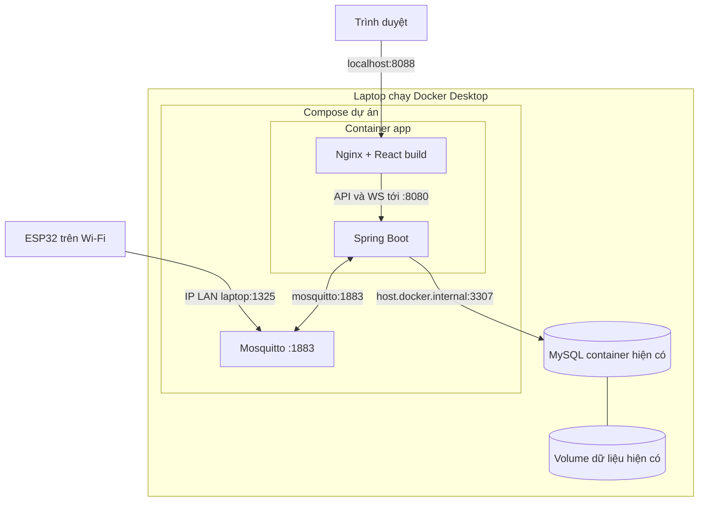

Compose hiện quản lý app và Mosquitto. MySQL vẫn là container riêng; `start.ps1` khởi động container cơ sở dữ liệu hiện có trước khi khởi động Compose. Vì vậy, chưa mô tả toàn bộ ba thành phần đều nằm trong cùng Compose. Cấu hình BTH4 tắt `IOT_LED_DEMO_ENABLED`; không có responder giả lập xác nhận LED trong luồng đang sử dụng.

Các công nghệ chính gồm React, Spring Boot/Java 17, MySQL 8 và Eclipse Mosquitto 2.0. Các thông số phiên bản của môi trường thu minh chứng được lưu trong [environment.json](../Evidence/2026-10-21/data/environment.json). Cấu hình hiện phục vụ mạng thực hành nội bộ; chưa triển khai TLS cho toàn bộ các kênh.

Đối chiếu cấu hình: [compose.yaml](../../compose.yaml), [compose.bth4.yaml](../../compose.bth4.yaml), [Dockerfile](../../Dockerfile), [Nginx](../../docker/nginx.conf).

## 3.2. Thiết kế phần cứng và firmware

### 3.2.1. Thành phần và nối dây

| Thành phần | Số lượng theo mô hình | Vai trò |
| --- | --- | --- |
| ESP32 | 1 | Kết nối Wi-Fi/MQTT, đọc cảm biến và điều khiển GPIO |
| DHT11 | 1 | Cung cấp nhiệt độ và độ ẩm |
| Cảm biến LDR, ngõ ra analog | 1 | Cung cấp giá trị ADC để ước lượng ánh sáng |
| LED | 2 | Thiết bị chấp hành của mô hình |
| Breadboard, dây, điện trở và nguồn | Theo mạch thật | Đấu nối và cấp nguồn |

| Tín hiệu | GPIO trong sketch hiện tại | Ghi chú cần đối chiếu |
| --- | --- | --- |
| DHT11 DATA | GPIO4 | Đối chiếu chân DATA và nguồn của module thật |
| LDR analog | GPIO34 | Đối chiếu AO, nguồn và dải điện áp thực tế |
| LED1 | GPIO18 | Đối chiếu chiều LED và điện trở |
| LED2 | GPIO19 | Đối chiếu chiều LED và điện trở |

**[CẦN BỔ SUNG — Hình 3.3]** Ảnh toàn bộ mạch của dự án.  
**[CẦN BỔ SUNG — Hình 3.4]** Ảnh cận chân nối hoặc sơ đồ nối dây đã đối chiếu.  
**[CẦN XÁC NHẬN]** Model board/module, nguồn cấp, điện trở thực tế và firmware đã nạp. GPIO trong bảng là thông tin từ mã nguồn trên máy, chưa thay cho xác nhận mạch và binary trên ESP32. Người thực hiện sẽ tự bổ sung ảnh vào [hardware-photos](../Evidence/2026-10-21/hardware-photos/README.md).

### 3.2.2. Luồng hoạt động firmware

Sketch khởi tạo cảm biến và GPIO, đặt hai LED về LOW, kết nối Wi-Fi và MQTT. Trong vòng lặp, chương trình duy trì kết nối MQTT, xử lý callback lệnh và thực hiện chu kỳ đọc cảm biến theo cấu hình khoảng 2 giây. Thời gian nhận thực tế có thể khác chu kỳ này do xử lý và truyền mạng.

**Hình 3.5. Luồng firmware theo mã nguồn hiện có.**

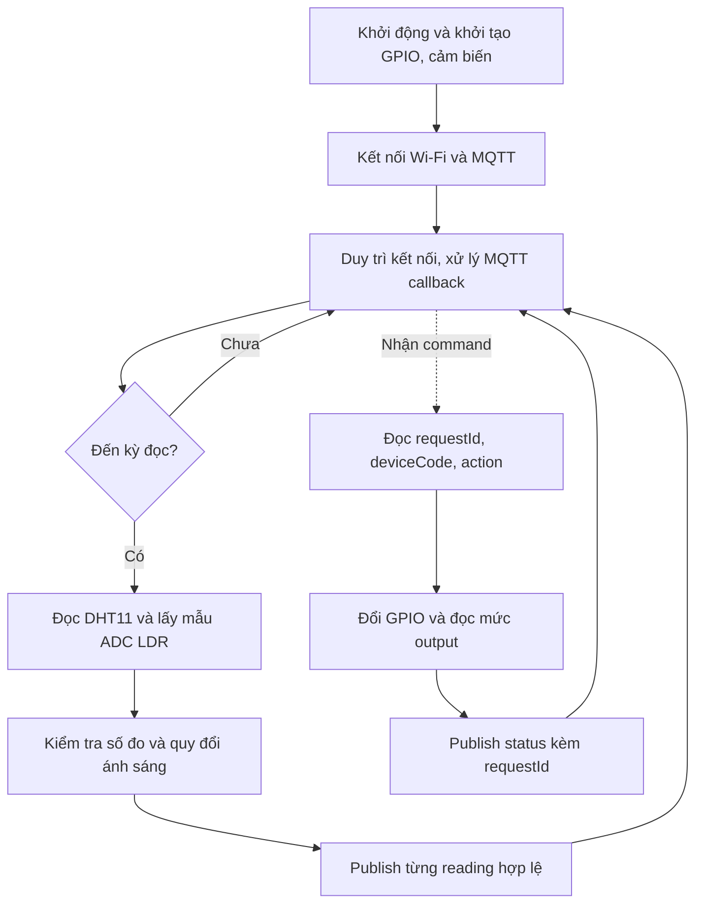

LDR được đọc trung bình 10 mẫu ADC trước khi quy đổi theo hàm `adcToLux`. Thang quy đổi hiện tại xấp xỉ 0–200 lux; đây là ước lượng chưa hiệu chuẩn. Trường hợp DHT đọc không hợp lệ có thể không phát reading tương ứng. Việc chương trình in các số đo cạnh nhau trên Serial không làm cho ba gói MQTT có cùng thời điểm đến Backend.

Callback điều khiển đọc `requestId`, `deviceCode`, `action`, đổi mức chân LED và publish trạng thái đọc từ chân output. Phản hồi này xác nhận mức GPIO theo chương trình, chưa có cảm biến phản hồi độc lập chứng minh LED phát sáng.

Nguồn đối chiếu: [IoTMonitor.ino](../../Hardware/ESP32/IoTMonitor/IoTMonitor.ino). Không đưa ảnh hoặc nội dung `config.h` có thông tin kết nối vào báo cáo.

## 3.3. Thiết kế cơ sở dữ liệu

### 3.3.1. Mô hình quan hệ

**Hình 3.6. ERD gồm năm bảng.**

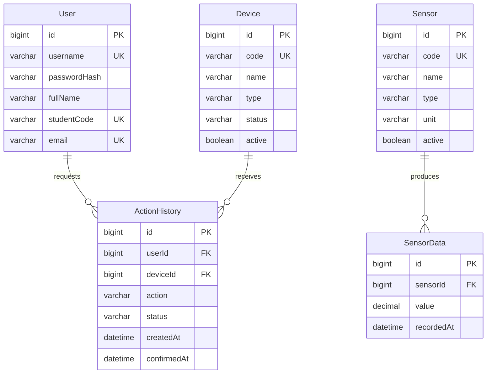

ERD hiển thị các cột chính để đọc quan hệ; từ điển đầy đủ nằm tại [Phụ lục dữ liệu](PHU_LUC_DU_LIEU.md). Khi đưa vào Word, có thể đặt các bảng từ điển ngay sau ERD. Nguồn SQL: [schema.sql](../../Backend/src/main/resources/schema.sql), đối chiếu với [cột DB thực tế](../Evidence/2026-10-21/data/db-columns.tsv) và [khóa ngoại](../Evidence/2026-10-21/data/db-foreign-keys.tsv).

### 3.3.2. Lựa chọn lưu trữ

SensorData lưu một reading bằng `DECIMAL(12,4)`, thời gian bằng `DATETIME(6)`. Các chỉ mục theo Sensor/thời gian và Device/thời gian hỗ trợ tra cứu lịch sử. Giá trị hiển thị trên Web có thể được định dạng còn một chữ số thập phân nhưng dữ liệu đã lưu không bị thay đổi theo cách trình bày đó.

ActionHistory liên kết người gửi và thiết bị. `confirmedAt` để NULL khi chưa có xác nhận; `requestId` dùng trong MQTT chính là khóa chính của hàng lịch sử. Các trạng thái xử lý PENDING, CONFIRMED và TIMEOUT được suy ra từ lịch sử và thời gian, không có bảng notification hoặc cột trạng thái thứ ba trong schema.

Bản cập nhật ngày 27/10 có ba User: user123, user124 và user125. Seed chỉ thêm username còn thiếu, không đặt lại tài khoản đã có; ràng buộc bắt buộc đúng một User đã được bỏ. Cột Người thực hiện dùng quan hệ ActionHistory.userId → User.id và trả `User.username` qua DTO, không tạo cột username trong ActionHistory. Vì vậy số bảng, 40 cột SQL và các khóa ngoại giữ nguyên.

Thời gian ghi nhận do Backend gán theo UTC. Payload hiện tại không mang thời gian lấy mẫu của ESP32, nên `recordedAt` biểu diễn thời gian Backend ghi nhận, không phải dấu thời gian đo tại cảm biến. Cơ sở dữ liệu có thể còn hàng từ BTH3; chỉ các ID được đối chiếu trong bộ bằng chứng mới dùng để kết luận về phiên ESP32 này.

## 3.4. Đăng nhập — UC01

### 3.4.1. Giao diện và thao tác

Người dùng nhập tên tài khoản và mật khẩu tại màn hình đăng nhập. Sau khi xác thực thành công, Frontend lưu thông tin phiên để gọi các API được bảo vệ và điều hướng tới Dashboard. Màn hình không cung cấp đăng ký hoặc quên mật khẩu.

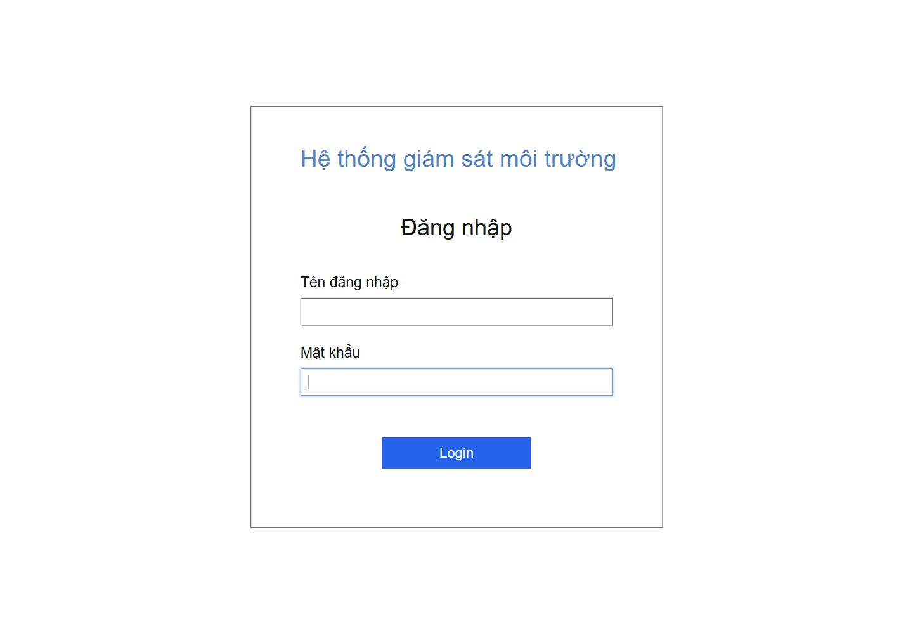

### 3.4.2. Luồng xử lý

**Hình 3.8. Sequence đăng nhập.**

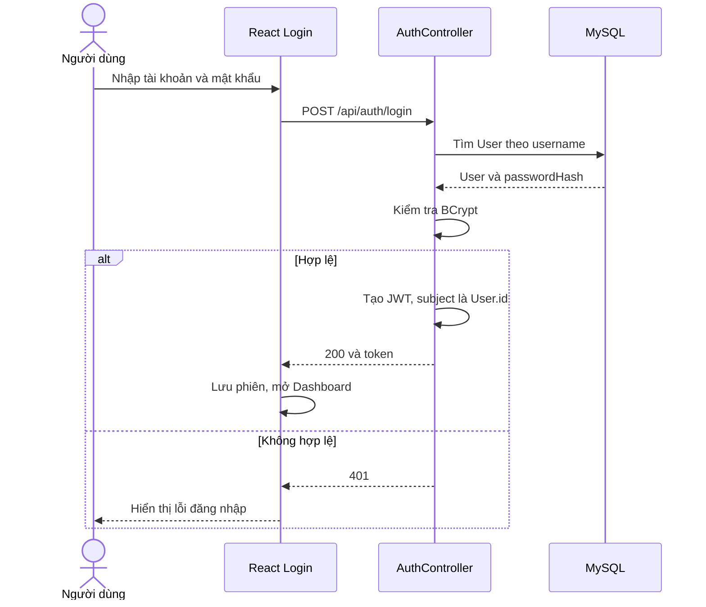

### 3.4.3. API, dữ liệu và bảo vệ phiên

| Thuộc tính | Nội dung |
| --- | --- |
| Endpoint | `POST /api/auth/login` |
| Body | `username`, `password` |
| Kết quả | 200 kèm token; 400 với dữ liệu không hợp lệ; 401 khi xác thực thất bại |
| Lưu trữ | User.passwordHash dùng BCrypt, không trả passwordHash về client |

Backend kiểm tra JWT cho REST theo cơ chế stateless. JWT sử dụng chữ ký HS256, issuer `iot-backend` và subject là User.id. Khi kết nối STOMP, client gửi Bearer token trong CONNECT để interceptor kiểm tra. Token thực và mật khẩu không xuất hiện trong ví dụ báo cáo.

Triển khai: [Login.jsx](../../Frontend/src/pages/Login.jsx), [ProtectedRoute.jsx](../../Frontend/src/components/ProtectedRoute.jsx), [api.js](../../Frontend/src/services/api.js), [AuthController.java](../../Backend/src/main/java/zygoo13/iot/api/AuthController.java), [SecurityConfig.java](../../Backend/src/main/java/zygoo13/iot/security/SecurityConfig.java).

### 3.4.4. Kiểm tra

Phiên thu minh chứng ngày 21/10 đã truy cập các trang và API được bảo vệ bằng phiên hợp lệ. Ngày 27/10 kiểm tra đăng nhập thành công cho cả user123, user124, user125; GET Profile trả đúng username từng tài khoản, History thiếu token trả 401. Ảnh đăng nhập chỉ minh họa UI. Chưa thực hiện đầy đủ bộ nhánh sai mật khẩu, token sai chữ ký hoặc hết hạn trong lượt cập nhật, vì vậy không đánh dấu các nhánh đó đã đạt chỉ từ ảnh màn hình. Xem [kết quả kiểm tra mới](../Evidence/2026-10-27/verification.json).

## 3.5. Dashboard và giám sát realtime — UC02

### 3.5.1. Giao diện

Dashboard gồm ba card giá trị, một biểu đồ môi trường ba đường, thông báo tình trạng phần cứng và hai card LED. Tên đại lượng và thiết bị được nhấn mạnh để dễ đọc. Khi phần cứng Offline, giao diện vẫn giữ số đo cuối, đồng thời chỉ rõ tình trạng kết nối; dữ liệu cũ không được coi là số đo vừa nhận.

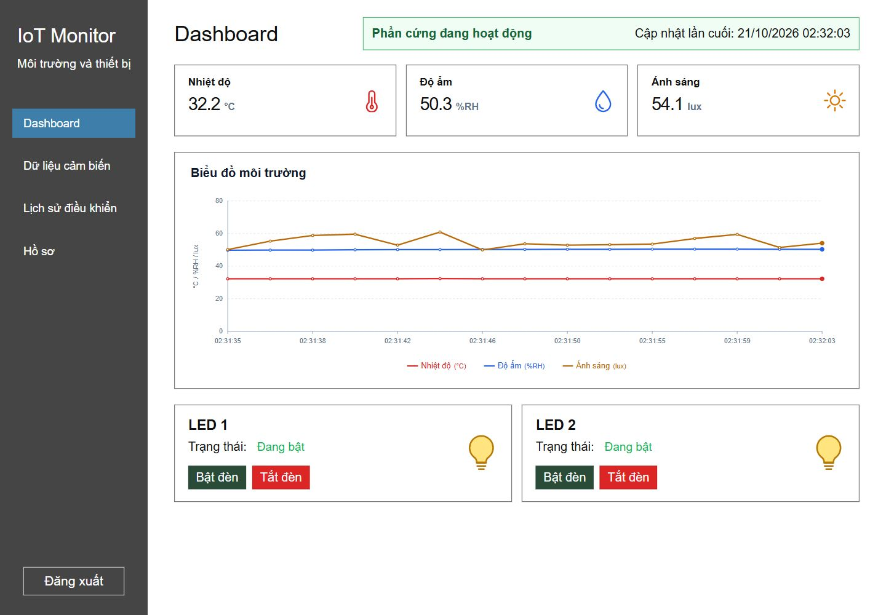

### 3.5.2. Tải ban đầu và duy trì kết nối

**Hình 3.10. Tải snapshot và kết nối realtime.**

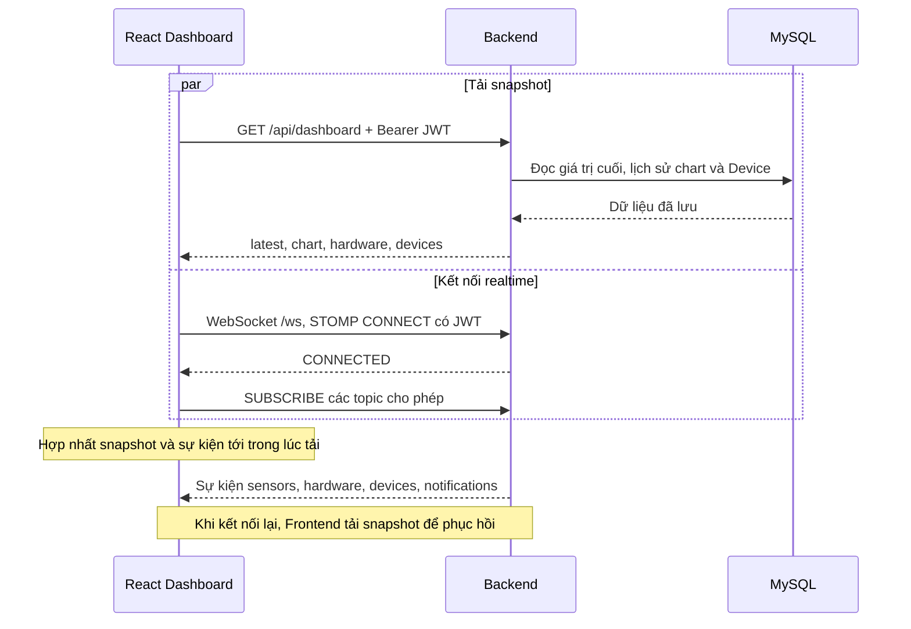

REST và kết nối realtime là các công việc bất đồng bộ; không giả định chúng luôn hoàn thành theo một thứ tự. Dashboard giữ các sự kiện đến trong lúc tải và hợp nhất với snapshot để tránh dữ liệu REST cũ ghi đè dữ liệu mới. Reading đến muộn không được kéo lùi giá trị mới nhất trên card.

### 3.5.3. Luồng telemetry

**Hình 3.11. Sequence ESP32 → MQTT → SQL → STOMP → Web.**

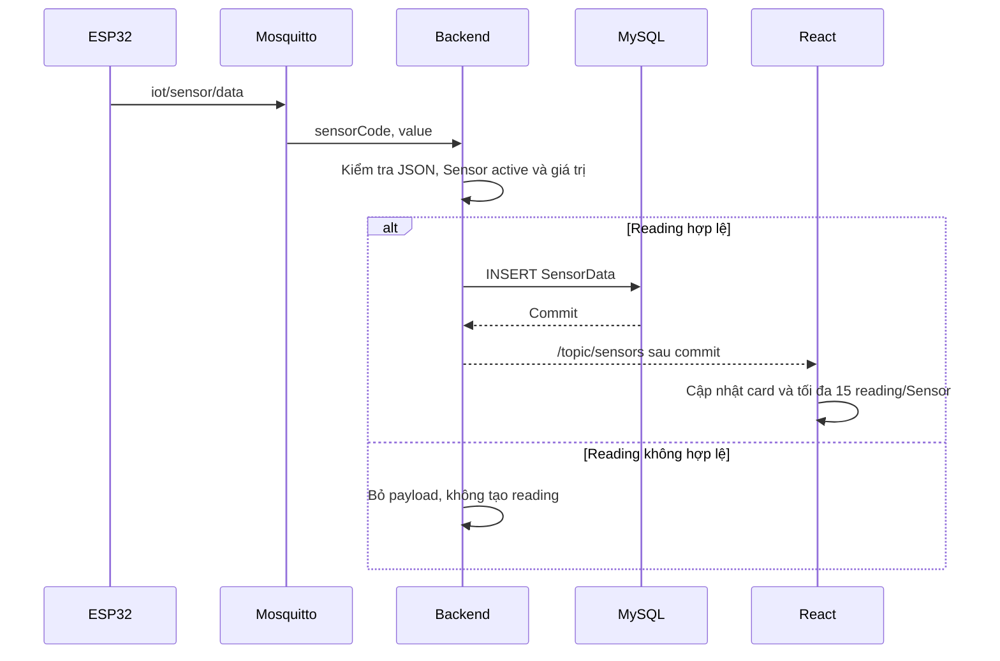

TelemetryService yêu cầu JSON đúng hai trường, Sensor hợp lệ và giá trị số hữu hạn. Độ ẩm phải trong khoảng 0–100; ánh sáng không âm. Reading được lưu trước khi RealtimePublisher phát sự kiện sau commit, giúp giao diện và dữ liệu tra cứu cùng dựa trên trạng thái đã ghi nhận.

### 3.5.4. API và message

`GET /api/dashboard` cung cấp `latest`, `chart`, `hardware`, `devices` và trường tương thích `ledDemo` đang false. Ba Sensor được nhận diện bằng mã, không dựa vào thứ tự phần tử trong mảng.

MQTT telemetry sử dụng topic `iot/sensor/data`:

```json
{"sensorCode":"DHT11_TEMP","value":32.3}
```

Sự kiện `/topic/sensors` bổ sung ID của hàng SQL, loại cảm biến, đơn vị và `recordedAt`. Các trường gồm `id`, `sensorCode`, `sensorType`, `value`, `unit`, `recordedAt`. `/topic/hardware` cung cấp trạng thái ONLINE/OFFLINE và `lastSeenAt` khi tình trạng thay đổi.

MQTT sử dụng QoS 0 trong cấu hình hiện tại. Backend bỏ gói retained của telemetry/status; báo cáo không suy diễn cơ chế truyền này bảo đảm không mất bản tin.

### 3.5.5. Thiết kế biểu đồ

Biểu đồ dùng một SVG chung với ba đường màu: đỏ cho nhiệt độ, xanh cho độ ẩm và vàng cho ánh sáng. Mỗi Sensor giữ tối đa 15 reading mới nhất theo thời gian. Trục X là các vị trí thứ tự cách đều, không phải trục thời gian liên tục. Khi mỗi Sensor đủ 15 reading, ba đường bắt đầu và kết thúc tại cùng các vị trí để tránh thừa/thiếu ở hai đầu do lệch thời gian nhận.

Nhãn thời gian lấy từ reading nhiệt độ tương ứng; khi không có nhiệt độ thì dùng nguồn dữ liệu còn lại. Các nhãn cập nhật khi nhận reading mới. Tooltip hiển thị giá trị, đơn vị và thời gian thật riêng của từng Sensor, vì các reading cùng vị trí không nhất thiết thuộc cùng một chu kỳ đo. Cách biểu diễn này phù hợp để so sánh xu hướng 15 reading gần nhất, nhưng không dùng để đo độ lệch thời gian giữa cảm biến.

Biểu đồ giữ nguyên giá trị và dùng chung một trục Y có ghi đơn vị °C/%RH/lux, không chuẩn hóa về phần trăm. Vì ba đại lượng khác đơn vị, khi ánh sáng lớn thì biến thiên nhỏ của nhiệt độ/độ ẩm có thể khó thấy. Chú giải cho phép ẩn/hiện đường để quan sát; luôn giữ ít nhất một đường. Màn hình hẹp giảm nhãn chữ, không giảm số điểm. Không có animation trượt theo đồng hồ hoặc tạo thêm số đo nội suy.

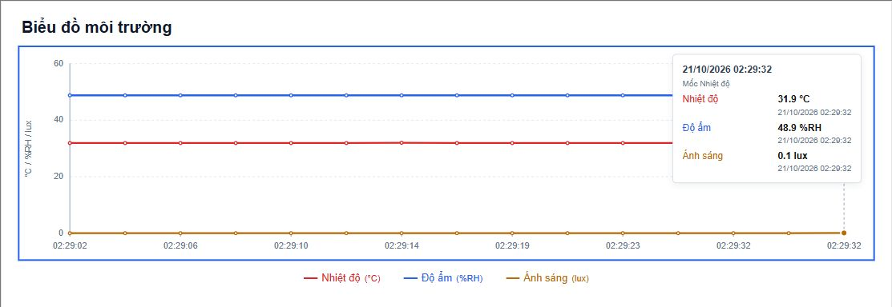

Nguồn: [Dashboard.jsx](../../Frontend/src/pages/Dashboard.jsx), [EnvironmentChart.jsx](../../Frontend/src/components/EnvironmentChart.jsx), [chartModel.js](../../Frontend/src/utils/chartModel.js), [dashboard.js](../../Frontend/src/utils/dashboard.js), [realtime.js](../../Frontend/src/services/realtime.js), [TelemetryService.java](../../Backend/src/main/java/zygoo13/iot/mqtt/TelemetryService.java), [RealtimePublisher.java](../../Backend/src/main/java/zygoo13/iot/ws/RealtimePublisher.java).

### 3.5.6. Kết quả quan sát

Trong khoảng 02:27:59–02:35:42 ngày 21/10/2026 theo giờ Việt Nam, bộ quan sát nhận 420 MQTT telemetry và 420 sự kiện STOMP cảm biến, gồm 140 reading cho mỗi Sensor. Đối chiếu 420 sự kiện STOMP với SQL theo ID, mã Sensor, giá trị và thời gian cho kết quả không có sai lệch trong tập này.

| Sensor | Số reading ở mỗi kênh MQTT/STOMP | Khoảng giá trị quan sát |
| --- | --- | --- |
| DHT11_TEMP | 140 / 140 | 31,7–32,3 °C |
| DHT11_HUM | 140 / 140 | 48,4–50,8 %RH |
| LDR_LIGHT | 140 / 140 | 0–200 lux ước lượng |

Người thực hiện đã thay đổi chiếu sáng/che cảm biến; ảnh và chuỗi dữ liệu ghi nhận biến đổi thật. Sau khi rút ESP32, Dashboard chuyển Offline và giữ dữ liệu cuối.

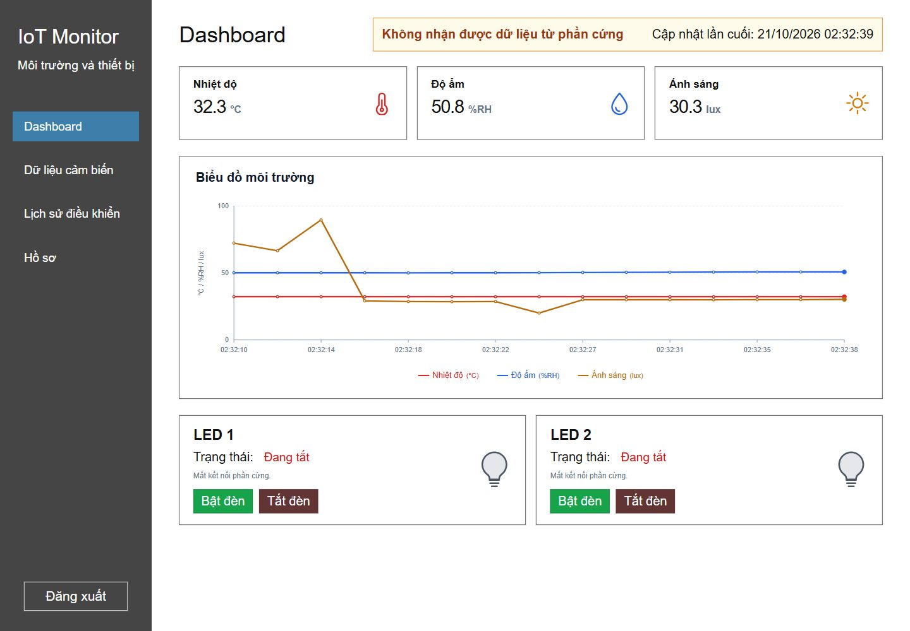

Nguồn: [F23 — đối chiếu telemetry](../Evidence/2026-10-21/F23_TELEMETRY.md). Kết quả chỉ chứng minh tập đã quan sát, chưa là phép thử tải hoặc độ ổn định dài hạn. Bộ quan sát vẫn có khoảng trống/burst nhận MQTT tới khoảng 10,25 giây; chưa xác định chính xác nguồn tại ESP32, Wi-Fi hay broker. Biểu đồ có thể cải thiện cách hiển thị nhưng không thể loại bỏ khoảng trống dữ liệu thực ở đầu vào. Payload thiếu timestamp/sampleId nên việc khớp giá trị theo thứ tự MQTT không đủ để chứng minh các reading cùng chu kỳ đo.

## 3.6. Điều khiển LED — UC03

### 3.6.1. Giao diện và trạng thái tương tác

Card LED hiển thị tên, trạng thái đã xác nhận, biểu tượng bóng đèn và hai nút Bật đèn/Tắt đèn. Nút thao tác tiếp theo được làm nổi: LED đang OFF thì Bật đèn sáng hơn; LED đang ON thì Tắt đèn sáng hơn. Trong thời gian chờ, giao diện thể hiện đang xử lý yêu cầu; không dùng việc bấm nút để tự khẳng định LED đã đổi.

Bản hiện tại dùng màu xanh cho thông báo lệnh ON và màu đỏ cho lệnh OFF; thông báo lỗi luôn đỏ. Màu dựa trên action của yêu cầu, tách với màu trạng thái đã xác nhận. Các ảnh pending ngày 21/10 bên dưới phản ánh giao diện tại lúc thu; không dùng chúng làm minh chứng màu thông báo sau cập nhật.

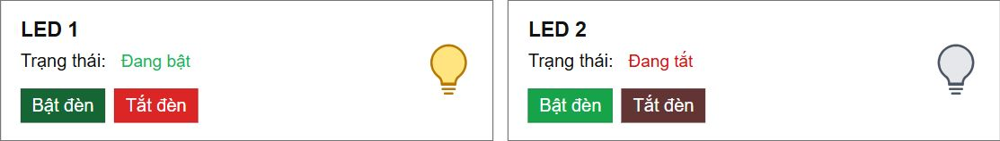

### 3.6.2. Luồng điều khiển và xác nhận

**Hình 3.15. Sequence điều khiển LED.**

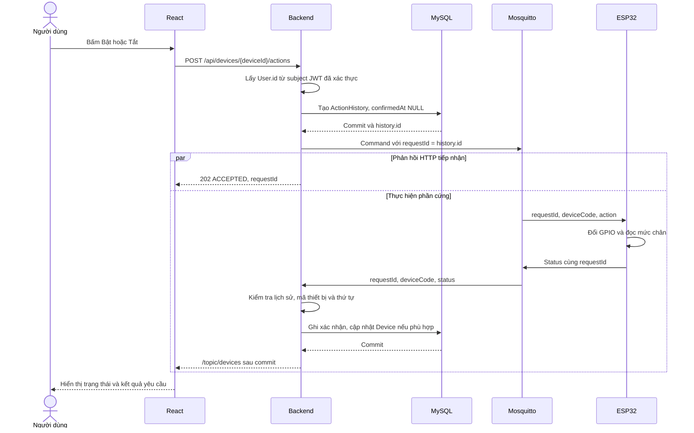

Lịch sử phải commit trước khi publish để phản hồi nhanh vẫn tìm được requestId. User của lịch sử lấy từ subject JWT, không nhận username hoặc userId do client khai trong body. Việc hỗ trợ ba tài khoản không thay MQTT payload hoặc requestId. HTTP và MQTT/STOMP là hai kênh bất đồng bộ; không giả định HTTP 202 luôn tới giao diện trước xác nhận. Nếu publish thất bại, Backend có thể trả 503 và giữ lịch sử chưa xác nhận để truy nguyên.

### 3.6.3. API và hợp đồng MQTT

| Thuộc tính | Nội dung |
| --- | --- |
| REST | `POST /api/devices/{deviceId}/actions` |
| Body | `{"action":"ON"}` hoặc `{"action":"OFF"}` |
| Tiếp nhận | 202, body có `requestId`, `status: "ACCEPTED"` |
| Lỗi chính | 400, 401, 404, 503; trường hợp đã lưu history có thể có requestId để tra cứu |
| Command topic | `iot/device/command` |
| Status topic | `iot/device/status` |

Ví dụ có thật trong phiên quan sát, không chứa thông tin xác thực:

```json
{"requestId":564,"deviceCode":"LED1","action":"ON"}
```

```json
{"requestId":564,"deviceCode":"LED1","status":"ON"}
```

Command và status giữ đúng ba trường. `/topic/devices` có `requestId`, `deviceCode`, `status`, `historyStatus`, `confirmedAt`, `deviceStatusUpdated`, `deliveryState`. `status` là trạng thái Device hiện tại; `historyStatus` thuộc request được xác nhận. Hai trường có thể khác nhau khi xác nhận cũ đến muộn.

### 3.6.4. Timeout, phản hồi muộn và chống ghi đè

| Trạng thái xử lý | Điều kiện | Tác động tới Device |
| --- | --- | --- |
| PENDING | Chưa xác nhận, chưa quá 10 giây | Giữ trạng thái đã ghi nhận |
| TIMEOUT | Chưa xác nhận sau ngưỡng 10 giây | Giữ trạng thái; phát thông báo timeout |
| CONFIRMED | Có phản hồi hợp lệ khớp requestId và Device | Cập nhật nếu không ghi đè yêu cầu mới hơn đã xác nhận |

Xác nhận hợp lệ đến muộn có thể hoàn tất lịch sử sau timeout. Khi đã có xác nhận đầu tiên, gói lặp không sửa lại thời điểm đó. Cơ chế kiểm tra yêu cầu mới hơn giúp tránh phản hồi cũ kéo lùi trạng thái Device.

**Hình 3.16. Nhánh không có xác nhận.**

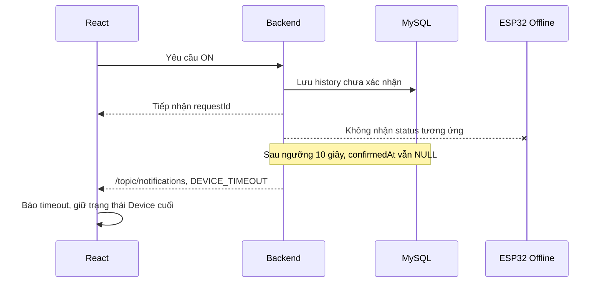

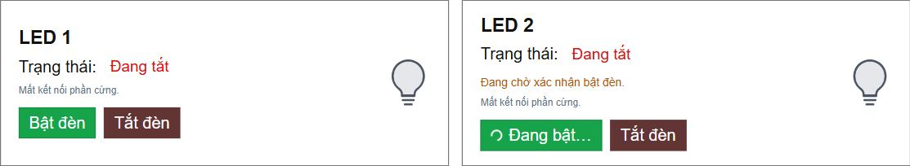

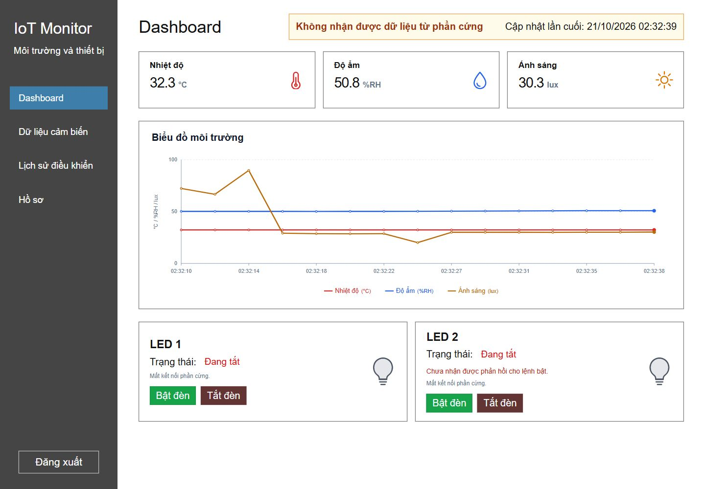

Triển khai: [DeviceControl.jsx](../../Frontend/src/components/DeviceControl.jsx), [DeviceCommandService.java](../../Backend/src/main/java/zygoo13/iot/api/DeviceCommandService.java), [DeviceStatusService.java](../../Backend/src/main/java/zygoo13/iot/mqtt/DeviceStatusService.java), [MqttGateway.java](../../Backend/src/main/java/zygoo13/iot/mqtt/MqttGateway.java).

### 3.6.5. Kết quả kiểm tra

| requestId | Thao tác từ Web | Kết quả | MQTT command → status tại cùng observer |
| --- | --- | --- | --- |
| 564 | LED1 ON | CONFIRMED | 140,350 ms |
| 565 | LED2 ON | CONFIRMED | 196,047 ms |
| 566 | LED1 OFF | CONFIRMED | 227,659 ms |
| 567 | LED2 OFF | CONFIRMED | 154,200 ms |
| 568 | LED1 ON sau khi rút ESP32 | TIMEOUT_VERIFIED | Không có status |
| 569 | LED2 ON sau khi rút ESP32 | TIMEOUT_VERIFIED | Không có status |

Bốn ca đầu được đối chiếu MQTT command/status, STOMP devices, SQL, REST và ảnh UI. Hai LED đã về OFF trước khi rút ESP32. Hai ca sau không có xác nhận tương ứng, `confirmedAt` vẫn NULL và Device giữ OFF. Notification có thời điểm bằng createdAt cộng 10 giây.

Khoảng thời gian trong bảng đo bằng một client quan sát command/status, không phải thời gian bóng LED phát sáng hoặc benchmark end to end. HTTP 202 được mô tả theo source/contract; phiên này không lưu response HTTP thô của lệnh. Các request 570–572 xuất hiện thêm nhưng không được quy cho sáu thao tác có kế hoạch, nên không cộng vào bảng kết quả trên. Ảnh mạch và Serial vẫn cần bổ sung để hoàn thiện bằng chứng vật lý.

Nguồn: [F24 — đối chiếu điều khiển](../Evidence/2026-10-21/F24_LED_CONTROL.md), [SQL lịch sử](../Evidence/2026-10-21/data/db-report-action-history.tsv).

## 3.7. Tra cứu dữ liệu cảm biến — UC04

### 3.7.1. Giao diện và thao tác

Trang Dữ liệu cảm biến hiển thị ID, loại cảm biến, giá trị và thời gian. Ô chọn Tìm theo xác định ý nghĩa của từ khóa: Tất cả, Nhiệt độ, Độ ẩm, Ánh sáng hoặc Thời gian. Việc đổi ô chọn chỉ chuẩn bị điều kiện tìm; truy vấn tìm kiếm được áp dụng khi bấm Tìm kiếm. Số dòng/trang nằm bên trái, tổng kết quả bên phải.

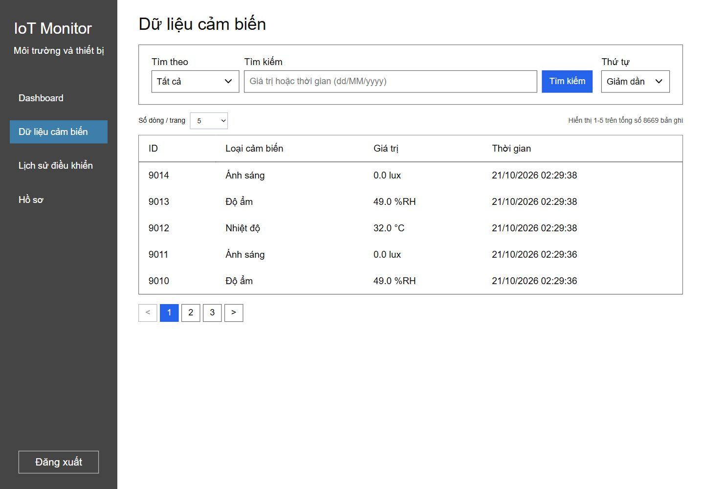

### 3.7.2. Luồng tra cứu

**Hình 3.20. Sequence tìm dữ liệu cảm biến.**

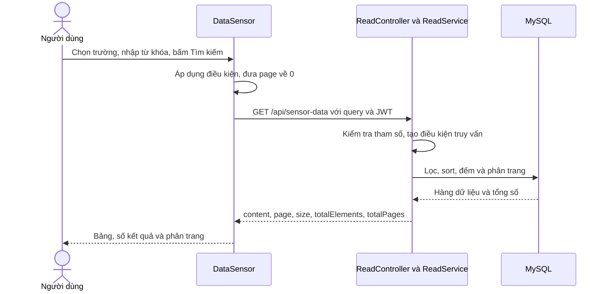

### 3.7.3. API và dữ liệu

`GET /api/sensor-data` nhận `page`, `size`, `sortBy`, `order`, `sensorType`, `searchField`, `search`, `from`, `to`. Loại cảm biến gồm TEMPERATURE/HUMIDITY/LIGHT; trường tìm gồm ALL/ID/SENSOR_TYPE/VALUE/TIME. Các trường sort được giới hạn bởi Backend. Lọc và phân trang thực hiện tại cơ sở dữ liệu, không chỉ trên năm dòng đang hiển thị.

Thời gian nhập theo ngày hoặc ngày giờ Việt Nam được Frontend chuyển thành khoảng UTC để gọi API. Một ngày tương ứng cả khoảng ngày theo múi giờ, không phải so sánh chuỗi định dạng trên Web. Trang mặc định 5 dòng, có thể chọn 5/10/15/20; thay điều kiện đã áp dụng sẽ trở về trang đầu.

Triển khai: [DataSensor.jsx](../../Frontend/src/pages/DataSensor.jsx), [dateTime.js](../../Frontend/src/utils/dateTime.js), [ReadController.java](../../Backend/src/main/java/zygoo13/iot/api/ReadController.java), [ReadService.java](../../Backend/src/main/java/zygoo13/iot/api/ReadService.java).

### 3.7.4. Kiểm tra

Đã lưu ảnh tìm giá trị nhiệt độ 32,0 °C cho 38 kết quả và ảnh tìm ngày 21/10/2026. Ảnh tìm theo ngày có các ID cuối 9282–9284 thuộc tập quan sát. Các ảnh này minh họa truy vấn thực, không đại diện cho kiểm thử đầy đủ mọi tổ hợp lọc/sort hoặc ranh giới ngày.

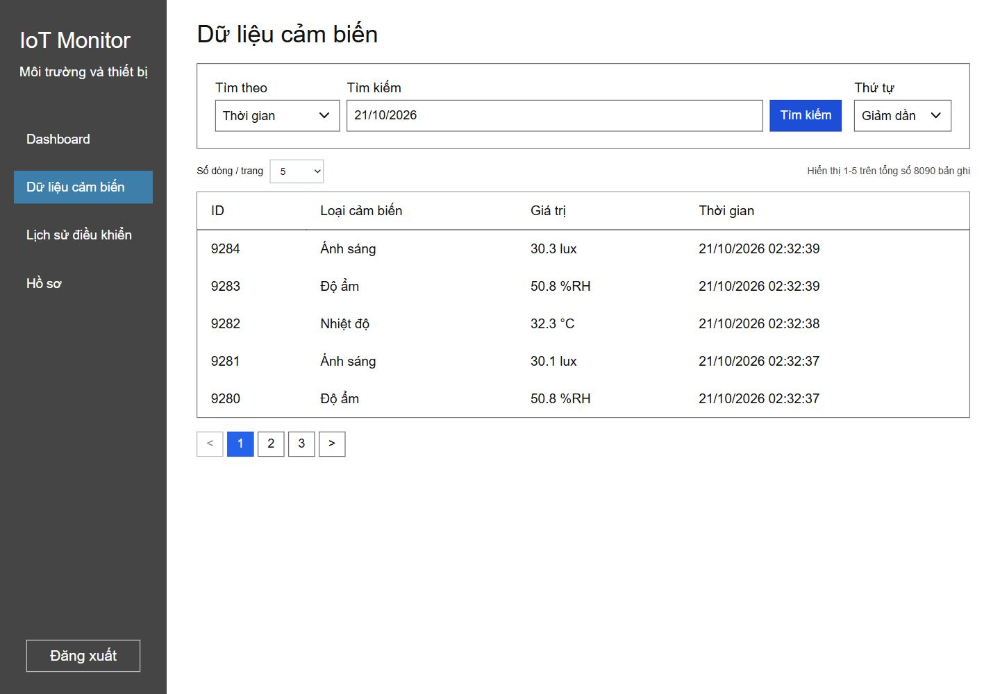

## 3.8. Lịch sử điều khiển — UC05

### 3.8.1. Giao diện và thao tác

Trang lịch sử hiển thị ID, thiết bị, người thực hiện, lệnh, trạng thái và thời gian. Người thực hiện là username gắn với User của từng ActionHistory; không thay đổi theo tài khoản đang xem trang. Backend xác định người gửi lệnh từ JWT, không nhận userId/username trong body điều khiển. Người dùng lọc theo thiết bị, ON/OFF, trạng thái và thời gian. Dropdown trạng thái đặt Tất cả ở đầu; Processing thể hiện yêu cầu còn chờ. Nút Xóa lọc có màu để dễ nhận biết thao tác đưa điều kiện về mặc định.

Cập nhật ngày 27/10/2026 bổ sung hai tài khoản user124 và user125 bên cạnh tài khoản chính đã có; seed không ghi đè tài khoản hoặc lịch sử cũ. Ảnh bên dưới được thu lại ngày 27/10 để thể hiện cột Người thực hiện. Lịch sử cũ vẫn giữ đúng người gửi ban đầu.

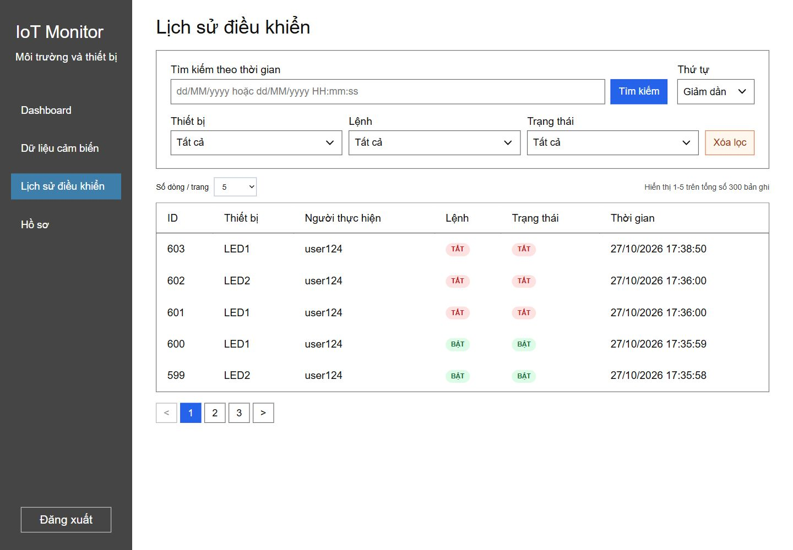

### 3.8.2. Luồng và API

**Hình 3.23. Sequence tra cứu lịch sử.**

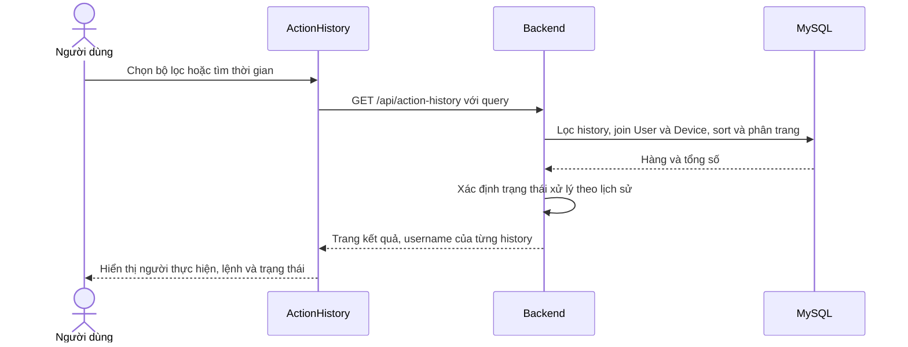

`GET /api/action-history` dùng `page`, `size`, `sortBy`, `order`, `device`, `action`, `status`, `searchField`, `search`, `from`, `to`. `device` là LED1/LED2; `action` ON/OFF; `status` ON/OFF/PROCESSING. Các ô lọc của trang lịch sử áp dụng khi thay đổi; tìm kiếm thời gian có thao tác xác nhận riêng trên giao diện.

Response vẫn gồm `content`, `page`, `size`, `totalElements`, `totalPages`. Mỗi HistoryRow có `id`, `deviceId`, `deviceCode`, **`username`**, `action`, `status`, `createdAt`, `confirmedAt`, `deliveryState`. Đây là bổ sung trường response, không thêm tham số lọc theo người dùng hoặc đổi body điều khiển. `username` là tên đăng nhập, không phải fullName; response không chứa passwordHash. Repository dùng EntityGraph tải User/Device cùng trang kết quả để tránh truy vấn thêm cho từng hàng.

Schema tham chiếu mới: [HistoryRow trong OpenAPI ngày 27/10](../Evidence/2026-10-27/data/openapi-no-examples.json). [Ghi chú hợp đồng và resource](RESOURCE_INDEX.md) liệt kê các trường và ảnh cần dùng.

Processing là trạng thái chờ được suy ra; cột SQL vẫn chỉ ON/OFF. Với yêu cầu ON bị timeout và Device vẫn OFF, giao diện có thể hiển thị trạng thái OFF. Chỉ nhìn nhãn OFF không đủ để khẳng định lệnh đã hoàn tất; phải đối chiếu `confirmedAt`, trạng thái xử lý và yêu cầu tương ứng.

Nguồn: [ActionHistory.jsx](../../Frontend/src/pages/ActionHistory.jsx), [ReadService.java](../../Backend/src/main/java/zygoo13/iot/api/ReadService.java).

### 3.8.3. Kiểm tra

Các ID 564–569 được đối chiếu với SQL và luồng MQTT/STOMP trong mục 3.6. Ảnh lọc Processing đã chụp sau khi các yêu cầu hết thời gian nên kết quả rỗng; không dùng ảnh đó làm bằng chứng đã hiển thị hàng PENDING. Bằng chứng trạng thái đang chờ thật nằm ở card LED trên Dashboard, Hình 3.17.

Ngày 27/10, test Backend cô lập xác nhận tác giả từ ba JWT, phân trang/lọc, body giả actor, seed lặp và bảng rỗng. Lượt kiểm tra cuối đã gửi sáu lệnh thật 617–622 dưới ba tài khoản tới ESP32, tất cả có MQTT status/STOMP/SQL/REST xác nhận đúng username. Hai lệnh Web 627/628 sau cắm lại cũng xác nhận. Xem [kết quả từng request](../Evidence/2026-10-27-final-review/data/planned-command-results.json); không gọi test H2 là test phần cứng.

## 3.9. Hồ sơ người dùng — UC06

### 3.9.1. Giao diện

Trang Hồ sơ trình bày thông tin người dùng, ảnh đại diện và các liên kết của dự án. Người dùng có thể mở chế độ sửa, lưu thay đổi hoặc hủy để trở về dữ liệu đã có. localStorage dùng cho phiên, không thay cho dữ liệu hồ sơ trong cơ sở dữ liệu.

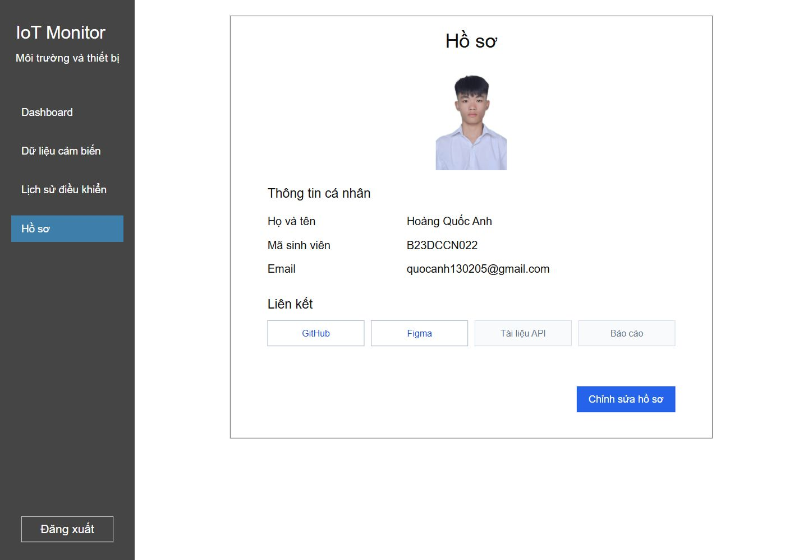

### 3.9.2. Luồng và API

**Hình 3.25. Sequence xem và sửa hồ sơ theo thiết kế.**

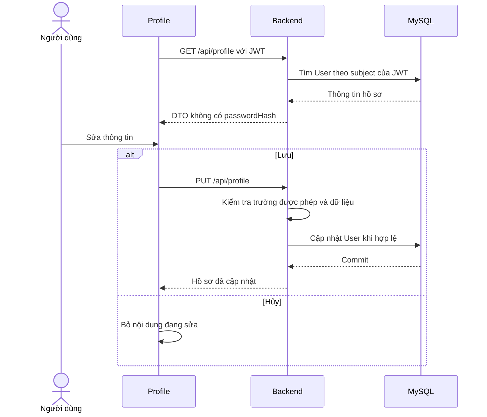

| Endpoint | Vai trò | Dữ liệu/nhánh chính |
| --- | --- | --- |
| `GET /api/profile` | Xem hồ sơ của người đang đăng nhập | Không trả mật khẩu hoặc hash |
| `PUT /api/profile` | Thay thế các trường hồ sơ được phép | fullName, studentCode, email, githubUrl, figmaUrl, apiDocsUrl, reportUrl, avatarUrl |

Họ tên, mã sinh viên và email là các trường bắt buộc; avatar sử dụng URL HTTPS theo kiểm tra hiện tại. Không cập nhật id, username hoặc passwordHash bằng API hồ sơ. Nhánh lỗi gồm 400 khi dữ liệu sai, 401 khi không có phiên hợp lệ, 409 khi xung đột dữ liệu duy nhất.

Triển khai: [Profile.jsx](../../Frontend/src/pages/Profile.jsx), [ProfileController.java](../../Backend/src/main/java/zygoo13/iot/api/ProfileController.java), [ProfileService.java](../../Backend/src/main/java/zygoo13/iot/api/ProfileService.java).

### 3.9.3. Kiểm tra

Phiên21/10 chỉ GET/mở sửa/Hủy. Lượt cuối27/10 đã PUT tạm user125, GET xác nhận, thử email trùng 409, avatarHTTP 400 và body username 400; cuối cùng khôi phục tám trường và xác nhận user123 không đổi. updatedAt của user125 có đổi do PUT. Xem [api-review](../Evidence/2026-10-27-final-review/data/api-review.json).

## 3.10. Tài liệu API, triển khai và quản lý cấu hình

### 3.10.1. Swagger/OpenAPI

Swagger mô tả bảy thao tác REST của hệ thống: đăng nhập, Dashboard, dữ liệu cảm biến, lịch sử, điều khiển LED, xem hồ sơ và sửa hồ sơ. Mỗi API được đặt cùng chức năng ở các mục trước; Swagger hỗ trợ tra cứu schema và thử có kiểm soát. Endpoint điều khiển và sửa hồ sơ có tác dụng ghi dữ liệu khi thực thi.

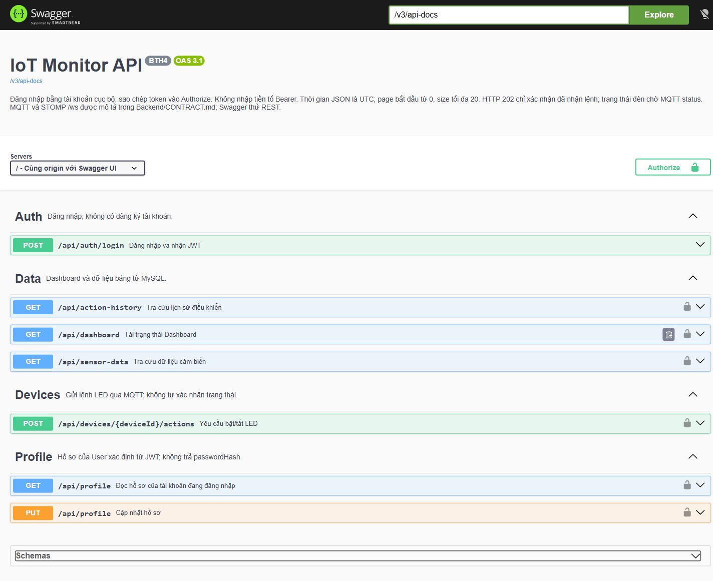

Schema username xem [ảnh HistoryRow](../Evidence/2026-10-27-final-review/images/swagger-historyrow-username.png).

Trong môi trường chạy, giao diện tài liệu tại `/swagger-ui/index.html`. Bản OpenAPI mới nhất đã lược các example để lưu bằng chứng an toàn: [snapshot ngày 27/10](../Evidence/2026-10-27/data/openapi-no-examples.json), có `HistoryRow.username` và vẫn bảy thao tác REST. [Bản ngày 21/10](../Evidence/2026-10-21/data/openapi-no-examples.json) chỉ đối chiếu phiên phần cứng cũ. Ảnh Swagger phía trên thu ngày 27/10 trong lượt cuối; ảnh schema username được lưu riêng, không dùng tổng quan endpoint để chứng minh trường schema. Tài liệu API không thay cho kết quả kiểm thử endpoint.

### 3.10.2. Khởi động và cấu hình

Khi vận hành theo hướng dẫn dự án, `start.ps1` khởi động cơ sở dữ liệu hiện có và các service Compose. React và Spring Boot được đóng gói trong app; broker chạy cùng Compose. Biến môi trường cung cấp kết nối DB, MQTT và khóa JWT. Các file chứa thông tin thật không đưa vào Git hoặc ảnh báo cáo.

Không đồng thời chạy Backend khác cùng nhận một luồng telemetry nếu chưa có cơ chế ngăn ghi trùng. MySQL sử dụng volume đã có; không xóa volume để đổi cấu hình hoặc làm lại ảnh. Mosquitto Windows không được tự chạy tranh cổng 1325 với broker Docker. Các bước khởi động cụ thể cần bám [README dự án](../../README.md) và [start.ps1](../../start.ps1), không thay tên biến môi trường bằng tên tự đặt.

### 3.10.3. WebSocket và bảo vệ truy cập

Ứng dụng dùng STOMP trên WebSocket native tại `/ws`, không dùng Socket.IO hoặc SockJS. JWT được kiểm tra trong CONNECT. Backend giới hạn origin/topic được phép và từ chối client gửi STOMP SEND để sửa dữ liệu nghiệp vụ. Các topic nhận là `/topic/sensors`, `/topic/hardware`, `/topic/devices`, `/topic/notifications`.

Frontend thử kết nối lại sau khoảng 5 giây và tải lại REST snapshot khi kết nối được khôi phục. Cơ chế này giúp phục hồi trạng thái sau mất kênh realtime; phiên thu minh chứng chưa thực hiện phép thử cắt broker hoặc mạng để kết luận đầy đủ về reconnect thực tế.

## 3.11. Tổng hợp kiểm thử tích hợp và giới hạn bằng chứng

| Hạng mục | Kết quả đã ghi nhận | Bằng chứng/giới hạn |
| --- | --- | --- |
| MQTT → Backend → SQL → STOMP | 420 reading STOMP khớp SQL; MQTT/STOMP cùng 140 giá trị theo thứ tự mỗi Sensor | [F23](../Evidence/2026-10-21/F23_TELEMETRY.md); không có sampleId chung |
| Dashboard và ánh sáng | Hiển thị dữ liệu, tooltip và biến đổi sau thao tác ánh sáng thật | Ảnh F10; lux chưa hiệu chuẩn |
| LED ON/OFF | Bốn request có xác nhận khớp MQTT/STOMP/SQL/REST/UI | [F24](../Evidence/2026-10-21/F24_LED_CONTROL.md); ảnh LED/Serial bổ sung riêng |
| Offline | Ghi nhận sau khi người dùng rút ESP32 | Ảnh F10f và hardware-state-events |
| LED không phản hồi | Hai request chưa xác nhận, timeout 10 giây, Device vẫn OFF | Request 568 và 569 |
| Sensor search | Có ảnh tìm giá trị và tìm ngày với dữ liệu thật | Chưa bao phủ mọi tổ hợp và ranh giới thời gian |
| History Processing | Chụp request 625 khi còn PENDING | [Ảnh thật](../Evidence/2026-10-27-final-review/images/history-processing-pending-row.png), sau đó timeout |
| Đa tài khoản, 27/10 | 3 tài khoản login, Profile đúng chủ thể, History khớp username trong SQL qua trang/lọc; thiếu token trả 401 | [verification.json](../Evidence/2026-10-27/verification.json); chỉ đọc, không gửi lệnh LED thật |
| Hồi quy, 27/10 | 4 test Backend và 12 test Frontend đạt; build/healthcheck thành công | Test tạo lệnh ba JWT dùng H2/MQTT mock, không cộng vào kết quả phần cứng |
| Profile PUT | PUT user125, xác nhận lưu và khôi phục tám trường; chặn dữ liệu sai/xung đột | Lượt cuối27/10; không coi updatedAt bất biến |
| Broker/Wi-Fi lỗi, ack muộn/lặp/đảo thứ tự | Chưa thử với phần cứng trong phiên | Logic source không thay bằng chứng thực nghiệm |
| Tải lớn, nhiều client, chạy dài hạn | Chưa đánh giá | Không đưa cam kết định lượng |

Các thời gian DB/JSON là UTC, còn ảnh UI theo giờ Việt Nam. Do đồng hồ giữa môi trường có thể khác, số đo trễ command/status sử dụng cùng observer; không trừ hai timestamp khác nguồn để suy ra độ trễ chính xác. Kết luận của báo cáo được giới hạn theo các phép thử đã thực hiện.

Bộ bằng chứng gốc có [README](../Evidence/2026-10-21/README.md), [danh mục ảnh](../Evidence/2026-10-21/IMAGE_CATALOG.md), JSON/TSV và SHA256 để kiểm tra tệp. Không thay ảnh thật bằng dữ liệu mô phỏng khi phần cứng đã được rút.

Bộ cập nhật [27/10](../Evidence/2026-10-27/README.md) bổ sung ảnh History, kiểm tra đa tài khoản và OpenAPI; không thay hoặc nâng kết quả phần cứng của bộ gốc. Tra [chỉ mục resource](RESOURCE_INDEX.md) để chọn đúng ảnh/schema khi viết bản cuối.

### Bổ sung rà soát phần cứng cuối ngày 27/10

522 reading trong session03 khớp MQTT/STOMP/SQL, 174 mỗi Sensor. Tám request 617–622/627–628 có xác nhận; bốn request623–626 không ACK và có timeout. Dashboard tự Offline/Online khi rút/cắm, Web điều khiển lại thành công. Có142 mục API PASS, 0 FAIL, 1 OBSERVED và kiểm tra giao diện tìm giá trị/thời gian, chú giải, tooltip, reload. [Bộ minh chứng cuối](../Evidence/2026-10-27-final-review/README.md) phân biệt các kết quả mới với bảng phiên 21/10 phía trên; không cộng thành một phiên đo.
